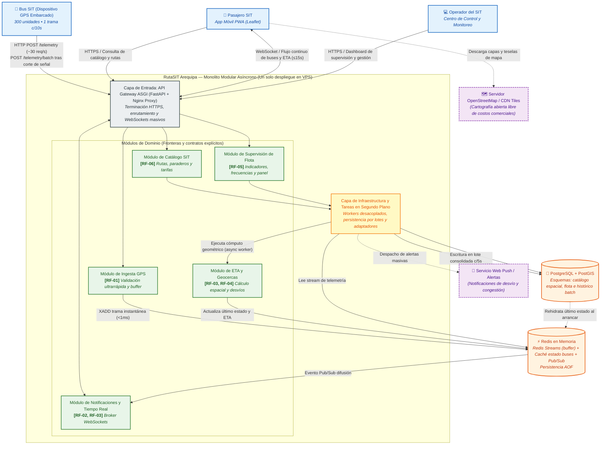
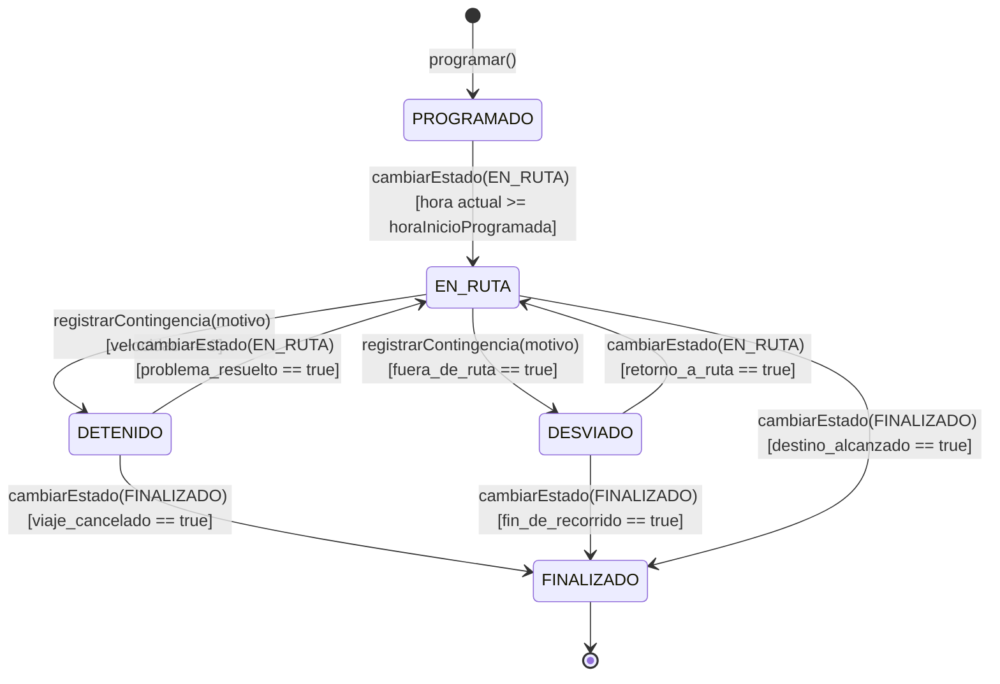
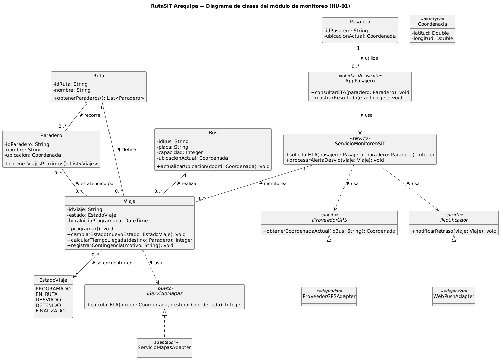
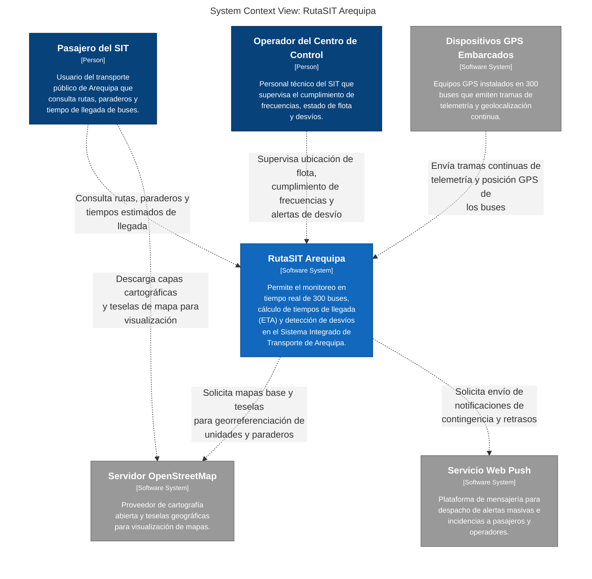
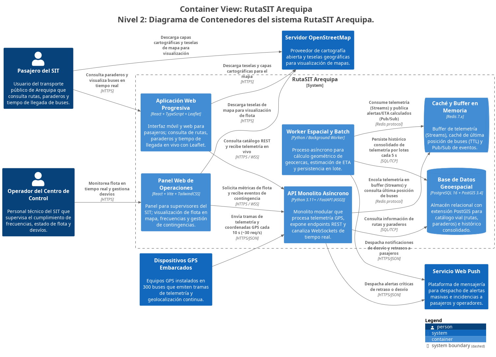

# RutaSIT Arequipa — Laboratorios 04, 05 y 06: Arquitectura, diseño UML y modelo C4
Construcción de Software · EPIS-UNSA · 2026-B · Grupo 06

## Integrantes
| Nombre | Rol en los laboratorios |
|--------|-------------------------|
| Arce Valencia Anderson Lino | Arquitecto líder y diagramador: drivers (Lab 04), diseño UML (Lab 05), modelo C4 en Structurizr DSL y vistas dinámica/despliegue (Lab 06) |
| Carlos Ccamaqque Wilson Freddy | Evaluador de trade-offs, redactor de ADR y verificador de IA: matriz de decisión y ADRs (Lab 04), consistencia (Lab 05), inventario C4, revisión c4model y bitácora IA (Lab 06) |

## Caso
**Caso 6 — RutaSIT Arequipa.** Sistema de seguimiento en tiempo real de los buses del Sistema Integrado de Transporte de Arequipa. Los 300 buses envían su posición GPS cada 10 segundos; el pasajero ve en un mapa dónde está su bus y cuánto falta para que llegue a su paradero, y el centro de control recibe alertas cuando un bus se desvía de su ruta o hay congestión. El MVP debe salir en 1 mes, con 2 desarrolladores y un único VPS de bajo costo.

**Atributo de calidad crítico: rendimiento en tiempo real.** Con unas 30 tramas por segundo y 1500 pasajeros conectados en hora punta, el cambio de posición debe llegar a la pantalla en 15 s o menos (p95). Ver [QA-01 en drivers.md](docs/architecture/drivers.md).

## Arquitectura elegida
Monolito modular asíncrono (FastAPI + Redis + PostgreSQL/PostGIS), elegido con 4.45/5 en la [matriz de decisión](docs/architecture/matriz-decision.md).

## Decisiones arquitectónicas
- [ADR-001: Estilo arquitectónico — monolito modular asíncrono con búfer en Redis](docs/architecture/adr/001-estilo-arquitectonico.md)
- [ADR-002: Base de datos geovial — PostgreSQL + PostGIS y Redis para el estado en vivo](docs/architecture/adr/002-base-de-datos-geovial.md)
- [ADR-003: Transmisión en tiempo real — WebSocket con Redis Pub/Sub](docs/architecture/adr/003-transmision-tiempo-real.md)
- [ADR-004: Puerto INotificador en eta_geocercas y adaptador en notificaciones (sin ciclos)](docs/architecture/adr/004-puerto-notificador-sin-ciclos.md)

## Entregables
| Código | Archivo |
|:---:|---|
| E1 | [docs/architecture/drivers.md](docs/architecture/drivers.md) |
| E2 | [docs/architecture/matriz-decision.md](docs/architecture/matriz-decision.md), [demostración del abogado del diablo](docs/architecture/demostracion-abogado-del-diablo.md) y gráfico [diagramas/matriz.py](docs/architecture/diagramas/matriz.py) → [imagen](docs/architecture/diagramas/img/matriz-decision.png) |
| E3 | [diagramas/arquitectura.mmd](docs/architecture/diagramas/arquitectura.mmd) → [imagen](docs/architecture/diagramas/img/arquitectura.png) |
| E4 | [docs/architecture/adr/](docs/architecture/adr/) |
| E5 | [diagramas/alternativa.puml](docs/architecture/diagramas/alternativa.puml) → [imagen](docs/architecture/diagramas/img/alternativa.png) |
| E6 | [diagramas/despliegue.py](docs/architecture/diagramas/despliegue.py) → [imagen](docs/architecture/diagramas/img/despliegue.png) |
| E7 | [docs/architecture/bitacora-ia.md](docs/architecture/bitacora-ia.md) |
| E8 | Este README |
| Cuestionario | [docs/cuestionario.md](docs/cuestionario.md) |
| Reto opcional | [.github/workflows/diagramas.yml](.github/workflows/diagramas.yml): regenera los PNG y SVG de los `.mmd` con mermaid-cli en cada push a `main` |

**Sobre la vista de despliegue:** `despliegue.py` se ejecutó con la librería Diagrams y Graphviz (`python docs/architecture/diagramas/despliegue.py` desde la raíz). El archivo `despliegue.puml` es una vista complementaria del mismo despliegue hecha en PlantUML ([imagen](docs/architecture/diagramas/img/despliegue-plantuml.png)); no reemplaza al script.

**Reto opcional:** la GitHub Action [`diagramas.yml`](.github/workflows/diagramas.yml) se ejecuta en cada push a `main` que modifique un archivo `.mmd` (o a mano desde la pestaña *Actions*). Instala mermaid-cli, vuelve a renderizar `arquitectura.mmd` en `diagramas/img/` y, si la imagen cambió, la sube con un commit de `github-actions[bot]`.

## Diseño UML (Lab 05)
Diseño detallado del módulo de monitoreo para la historia [HU-01: consultar el tiempo de llegada del bus](docs/design/historia.md), coherente con el ADR-001. Los diagramas están escritos como código (PlantUML y Mermaid) y versionados en `docs/design/`.

### Máquina de estados del Viaje (E3)

### Entregables del Lab 05
| Código | Archivo | Imagen |
|:---:|---|---|
| E1 | [historia.md](docs/design/historia.md), [clases.puml](docs/design/clases.puml) | [clases.png](docs/design/img/clases.png) |
| E2 | [secuencia-consultar-tiempo.puml](docs/design/secuencia-consultar-tiempo.puml) | [secuencia-consultar-tiempo.png](docs/design/img/secuencia-consultar-tiempo.png) |
| E3 | [estados-viaje.mmd](docs/design/estados-viaje.mmd) | [estados-viaje.png](docs/design/img/estados-viaje.png) |
| E4 | [actividades-deteccion-desvio.puml](docs/design/actividades-deteccion-desvio.puml) | [actividades-deteccion-desvio.png](docs/design/img/actividades-deteccion-desvio.png) |
| E5 | [paquetes.puml](docs/design/paquetes.puml), [ADR-004](docs/architecture/adr/004-puerto-notificador-sin-ciclos.md) | [paquetes.png](docs/design/img/paquetes.png) |
| E6 | [src/monitoreo/dominio.py](src/monitoreo/dominio.py), [round-trip.md](docs/design/round-trip.md), [classes_monitoreo.puml](docs/design/classes_monitoreo.puml) | [classes_monitoreo.png](docs/design/img/classes_monitoreo.png) |
| E7 | [consistencia.md](docs/design/consistencia.md), [bitacora-ia.md](docs/design/bitacora-ia.md) | — |
| E8 | Esta sección, [cuestionario-lab05.md](docs/design/cuestionario-lab05.md) y la etiqueta `v0.5-diseno` | — |

Diagrama de clases:

## Arquitectura C4 (Lab 06)
Modelo de arquitectura de software para **RutaSIT Arequipa** bajo el **modelo C4** (Contexto, Contenedores, Componentes y Código). Todo el modelo está formalizado como código utilizando **Structurizr DSL** (`workspace.dsl`) como **fuente única de verdad (Single Source of Truth)**, asegurando coherencia bidireccional con el [ADR-001](docs/architecture/adr/001-estilo-arquitectonico.md) (monolito modular asíncrono con FastAPI, Redis y PostgreSQL/PostGIS) y el diseño de componentes del [Laboratorio 05](docs/design/).

### Diagrama de Contexto del Sistema (Nivel 1)

El diagrama de contexto ubica a RutaSIT Arequipa en su entorno operacional, identificando a los actores directos (pasajeros y operadores de flota) y las interacciones con sistemas externos (sensores GPS en buses, mapas abiertos OSM y servicios push de contingencia):

### Vistas del Modelo C4

A continuación se presentan los enlaces a las imágenes renderizadas de las cinco vistas obligatorias del modelo:

| Nivel / Vista | Descripción | Imagen renderizada |
|---|---|:---:|
| **Nivel 1: Contexto del Sistema** | Zoom panorámico: Personas, RutaSIT y Sistemas Externos (`GPS`, `OSM`, `Web Push`). | [structurizr-Contexto.png](docs/architecture/c4/img/structurizr-Contexto.png) |
| **Nivel 2: Contenedores** | Topología de 6 contenedores (`pwa`, `panel`, `api`, `worker`, `redis`, `db`), tecnologías y protocolos explícitos. | [structurizr-Contenedores.png](docs/architecture/c4/img/structurizr-Contenedores.png) |
| **Nivel 3: Componentes** | Interior del contenedor API: Ingesta GPS, ETA/Geocercas, Notificaciones, Catálogo y Supervisión. | [structurizr-Componentes.png](docs/architecture/c4/img/structurizr-Componentes.png) |
| **Vista Dinámica (HU-01)** | Flujo temporal de 8 pasos para consultar y recibir la actualización del tiempo de llegada del bus. | [structurizr-ConsultarTiempoLlegada.png](docs/architecture/c4/img/structurizr-ConsultarTiempoLlegada.png) |
| **Vista de Despliegue (Producción)** | Nodos cliente (Smartphone, PC) y VPS Ubuntu 24.04 ($\le \$12$/mes) con contenedores Docker Compose. | [structurizr-Despliegue.png](docs/architecture/c4/img/structurizr-Despliegue.png) |

#### Nivel 2: Diagrama de Contenedores

### Entregables del Lab 06
| Código | Archivo | Descripción del entregable |
|:---:|---|---|
| E1 | [inventario.md](docs/architecture/c4/inventario.md), [workspace.dsl](docs/architecture/c4/workspace.dsl) | Inventario de elementos C4 clasificados por origen y vista de Contexto N1 |
| E2 | [workspace.dsl](docs/architecture/c4/workspace.dsl) | Vista de Contenedores con 6 contenedores, tecnologías y protocolos |
| E3 | [workspace.dsl](docs/architecture/c4/workspace.dsl) | Vista de Componentes del contenedor API coherente con `docs/design/paquetes.puml` |
| E4 | [workspace.dsl](docs/architecture/c4/workspace.dsl), [comparacion.md](docs/architecture/c4/comparacion.md) | Vista Dinámica de HU-01 (8 pasos) y comparación conceptual con Secuencia UML |
| E5 | [workspace.dsl](docs/architecture/c4/workspace.dsl) | Vista de Despliegue en entorno "Producción" con Docker Compose en VPS de bajo costo |
| E6 | [export/](docs/architecture/c4/export/), [img/](docs/architecture/c4/img/), [contexto-manual.puml](docs/architecture/c4/contexto-manual.puml), [comparacion.md](docs/architecture/c4/comparacion.md) | Exportación automática CLI (PlantUML/Mermaid), renderizado PNG, diagrama manual y comparativa |
| E7 | [revision-c4.md](docs/architecture/c4/revision-c4.md), [explicacion.md](docs/architecture/c4/explicacion.md), [bitacora-ia.md](docs/architecture/bitacora-ia.md) | Lista de revisión c4model.com aplicada a las 5 vistas, falsos positivos de IA, explicación para no técnicos ($\le 120$ palabras) e interacciones registradas |
| E8 | Este README, [cuestionario.md](docs/architecture/c4/cuestionario.md) y etiqueta `v0.6-c4` | Sección C4 en README, diagrama de contexto Mermaid, enlaces a las 5 vistas, cuestionario y tag de entrega |

### Revisión Cruzada e Instrucciones de Entrega
- **Revisión cruzada entre grupos:** Se revisa el diagrama de contenedores del grupo asignado utilizando la lista de revisión oficial de c4model.com (claridad de nombres, tecnologías explícitas, protocolos en flechas unidireccionales y justificación de límites) y se registran las observaciones mediante un *Issue* en GitHub. Las observaciones recibidas en nuestro repositorio se responden y corrigen de manera oportuna.
- **Etiqueta de entrega:** Versión etiquetada con `v0.6-c4` en Git.

## Reflexión sobre el uso de la IA
La IA nos ahorró mucho tiempo en lo mecánico: armar la estructura de los drivers, escribir la sintaxis de Mermaid, PlantUML y Diagrams, y proponer alternativas que no habíamos pensado, como la variante de Django con un ingestor aparte. Donde más nos sirvió fue como abogado del diablo, porque nos obligó a ver que nuestra opción favorita podía bloquear el event loop o perder el estado si Redis se caía.
También cometió errores, y no siempre se notaban. Primero sugirió microservicios con brokers pesados para un equipo de 2 personas, y en la crítica a la Alternativa A dio cifras alarmantes ("agota los workers", "100 % de I/O") que no resistieron un cálculo simple con la Ley de Little. En el Laboratorio 06, sugirió eliminar la relación directa entre el worker y PostgreSQL bajo una falsa premisa de aislamiento de microservicios; fue descartada gracias a la lista de revisión oficial de c4model.com.
Aprendimos a tratar cada número que da la IA como una hipótesis: pasarlo a carga por segundo, compararlo con las restricciones de `drivers.md` y no copiarlo a un documento sin una fuente o un cálculo. La IA propone, pero las decisiones y su defensa son nuestras.
