# RutaSIT Arequipa — Laboratorios 04, 05 y 06: Arquitectura, diseño UML y modelo C4

## Patrones de diseño (Laboratorio 07)

El flujo `consultar_tiempo_llegada` tiene una versión inicial conservada en `src/monitoreo/antes/servicio.py` y una versión distribuida en `src/monitoreo/`. Los commits E1–E5 registran la implementación de Anderson; la revisión de Wilson con Codex está en [su bitácora](docs/design/patrones/bitacora-wilson-codex.md), las [métricas](docs/design/patrones/metricas.md), el [cuestionario](docs/design/patrones/cuestionario-lab07.md) y el [ADR-005 propuesto](docs/architecture/adr/005-patrones-de-diseno.md).

| Olor inicial | Patrón | Prueba representativa |
|---|---|---|
| `if/elif` de algoritmos ETA | Strategy + fábrica registrable | `test_open_closed_nueva_estrategia_sin_modificar_servicio` |
| SDK GPS con formatos distintos | Adapter + fábrica registrable | `test_adaptadores_convierten_correctamente_sin_reglas_de_negocio` |
| Condicionales del estado del viaje | State | `test_state_transicion_invalida_lanza_excepcion` |
| Emisión manual de avisos | Observer | `test_observer_nuevo_suscriptor_sin_tocar_el_servicio` |
| Reintentos y caché transversales | Decorator | `test_decorator_reintentos_gps_sobre_adaptador` |
| Validaciones secuenciales de salida IA | Chain of Responsibility | `test_ia_guardrail_consistencia_bloquea_alucinaciones` |

| Radon 6.0.1 | Antes | Después |
|---|---:|---:|
| Complejidad de `consultar_tiempo_llegada` | D (25) | A (3) |
| Promedio de `servicio.py` | B (6,75) | A (1,68) |
| SLOC de `servicio.py` | 124 | 152 |
| Pruebas en la suite actual | — | 40 aprobadas |

Fuentes de los siete diagramas de patrones: [docs/design/patrones/](docs/design/patrones/). La etiqueta `v0.7-patrones` y la revisión por Pull Request aún no constan en este checkout.
Construcción de Software · EPIS-UNSA · 2026-B · Grupo 06

## Integrantes
| Nombre | Rol en los laboratorios |
|--------|-------------------------|
| Arce Valencia Anderson Lino | Arquitecto líder y diagramador: drivers (Lab 04), diseño UML (Lab 05), modelo C4 en Structurizr DSL y vistas dinámica/despliegue (Lab 06) |
| Carlos Ccamaqque Wilson Freddy | Evaluador de trade-offs, redactor de ADR y verificador de IA: matriz de decisión y ADRs (Lab 04), consistencia (Lab 05), inventario C4, revisión c4model y bitácora IA (Lab 06) |

## Caso
**Caso 6 — RutaSIT Arequipa.** Sistema de seguimiento en tiempo real de los buses del Sistema Integrado de Transporte de Arequipa. Los 300 buses envían su posición GPS cada 10 segundos; el pasajero ve en un mapa dónde está su bus y cuánto falta para que llegue a su paradero, y el centro de control recibe alertas cuando un bus se desvía de su ruta o hay congestión. El MVP debe salir en 1 mes, con 2 desarrolladores y un único VPS de bajo costo.

**Atributo de calidad crítico: rendimiento en tiempo real.** Con unas 30 tramas por segundo y 1500 pasajeros conectados en hora punta, el cambio de posición debe llegar a la pantalla en 15 s o menos (p95). Ver [QA-01 en drivers.md](docs/architecture/drivers.md).

## Arquitectura elegida
Monolito modular asíncrono (FastAPI + Redis + PostgreSQL/PostGIS), elegido con 4.45/5 en la [matriz de decisión](docs/architecture/matriz-decision.md).

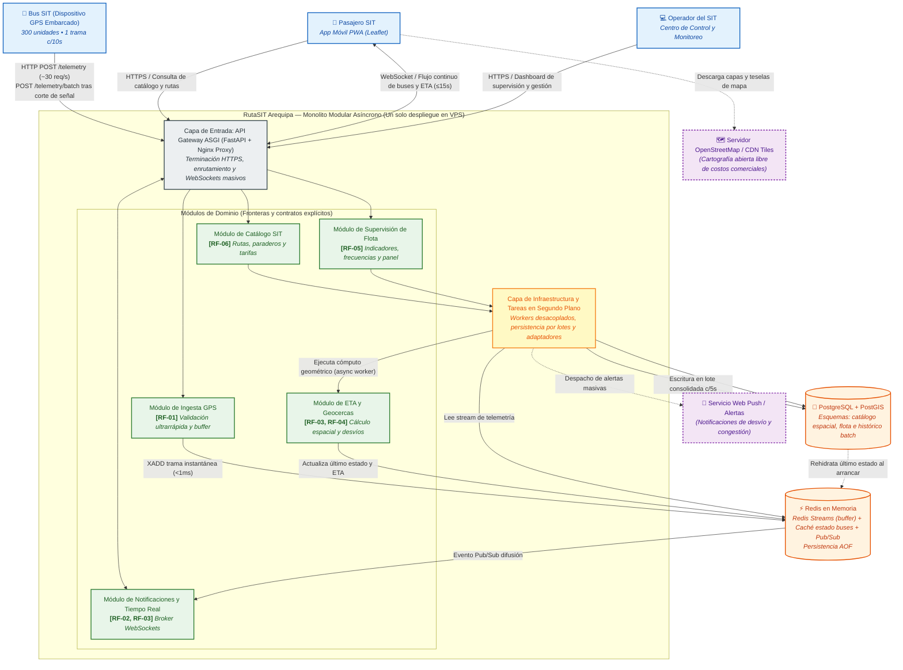

## Decisiones arquitectónicas
- [ADR-001: Estilo arquitectónico — monolito modular asíncrono con búfer en Redis](docs/architecture/adr/001-estilo-arquitectonico.md)
- [ADR-002: Base de datos geovial — PostgreSQL + PostGIS y Redis para el estado en vivo](docs/architecture/adr/002-base-de-datos-geovial.md)
- [ADR-003: Transmisión en tiempo real — WebSocket con Redis Pub/Sub](docs/architecture/adr/003-transmision-tiempo-real.md)
- [ADR-004: Puerto INotificador en eta_geocercas y adaptador en notificaciones (sin ciclos)](docs/architecture/adr/004-puerto-notificador-sin-ciclos.md)

## Entregables
| Código | Archivo |
|:---:|---|
| E1 | [docs/architecture/drivers.md](docs/architecture/drivers.md) |
| E2 | [docs/architecture/matriz-decision.md](docs/architecture/matriz-decision.md), [demostración del abogado del diablo](docs/architecture/demostracion-abogado-del-diablo.md) y gráfico [diagramas/matriz.py](docs/architecture/diagramas/matriz.py) → [imagen](docs/architecture/diagramas/img/matriz-decision.png) |
| E3 | [diagramas/arquitectura.mmd](docs/architecture/diagramas/arquitectura.mmd) → [imagen](docs/architecture/diagramas/img/arquitectura.png) |
| E4 | [docs/architecture/adr/](docs/architecture/adr/) |
| E5 | [diagramas/alternativa.puml](docs/architecture/diagramas/alternativa.puml) → [imagen](docs/architecture/diagramas/img/alternativa.png) |
| E6 | [diagramas/despliegue.py](docs/architecture/diagramas/despliegue.py) → [imagen](docs/architecture/diagramas/img/despliegue.png) |
| E7 | [docs/architecture/bitacora-ia.md](docs/architecture/bitacora-ia.md) |
| E8 | Este README |
| Cuestionario | [docs/cuestionario.md](docs/cuestionario.md) |
| Reto opcional | [.github/workflows/diagramas.yml](.github/workflows/diagramas.yml): regenera los PNG y SVG de los `.mmd` con mermaid-cli en cada push a `main` |

**Sobre la vista de despliegue:** `despliegue.py` se ejecutó con la librería Diagrams y Graphviz (`python docs/architecture/diagramas/despliegue.py` desde la raíz). El archivo `despliegue.puml` es una vista complementaria del mismo despliegue hecha en PlantUML ([imagen](docs/architecture/diagramas/img/despliegue-plantuml.png)); no reemplaza al script.

**Reto opcional:** la GitHub Action [`diagramas.yml`](.github/workflows/diagramas.yml) se ejecuta en cada push a `main` que modifique un archivo `.mmd` (o a mano desde la pestaña *Actions*). Instala mermaid-cli, vuelve a renderizar `arquitectura.mmd` en `diagramas/img/` y, si la imagen cambió, la sube con un commit de `github-actions[bot]`.

## Diseño UML (Lab 05)
Diseño detallado del módulo de monitoreo para la historia [HU-01: consultar el tiempo de llegada del bus](docs/design/historia.md), coherente con el ADR-001. Los diagramas están escritos como código (PlantUML y Mermaid) y versionados en `docs/design/`.

### Máquina de estados del Viaje (E3)
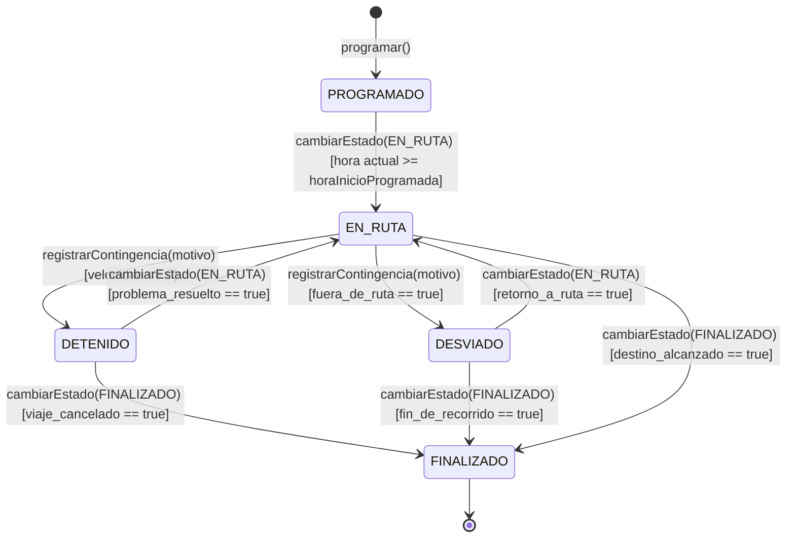

### Entregables del Lab 05
| Código | Archivo | Imagen |
|:---:|---|---|
| E1 | [historia.md](docs/design/historia.md), [clases.puml](docs/design/clases.puml) | [clases.png](docs/design/img/clases.png) |
| E2 | [secuencia-consultar-tiempo.puml](docs/design/secuencia-consultar-tiempo.puml) | [secuencia-consultar-tiempo.png](docs/design/img/secuencia-consultar-tiempo.png) |
| E3 | [estados-viaje.mmd](docs/design/estados-viaje.mmd) | [estados-viaje.png](docs/design/img/estados-viaje.png) |
| E4 | [actividades-deteccion-desvio.puml](docs/design/actividades-deteccion-desvio.puml) | [actividades-deteccion-desvio.png](docs/design/img/actividades-deteccion-desvio.png) |
| E5 | [paquetes.puml](docs/design/paquetes.puml), [ADR-004](docs/architecture/adr/004-puerto-notificador-sin-ciclos.md) | [paquetes.png](docs/design/img/paquetes.png) |
| E6 | [src/monitoreo/dominio.py](src/monitoreo/dominio.py), [round-trip.md](docs/design/round-trip.md), [classes_monitoreo.puml](docs/design/classes_monitoreo.puml) | [classes_monitoreo.png](docs/design/img/classes_monitoreo.png) |
| E7 | [consistencia.md](docs/design/consistencia.md), [bitacora-ia.md](docs/design/bitacora-ia.md) | — |
| E8 | Esta sección, [cuestionario-lab05.md](docs/design/cuestionario-lab05.md) y la etiqueta `v0.5-diseno` | — |

Diagrama de clases:

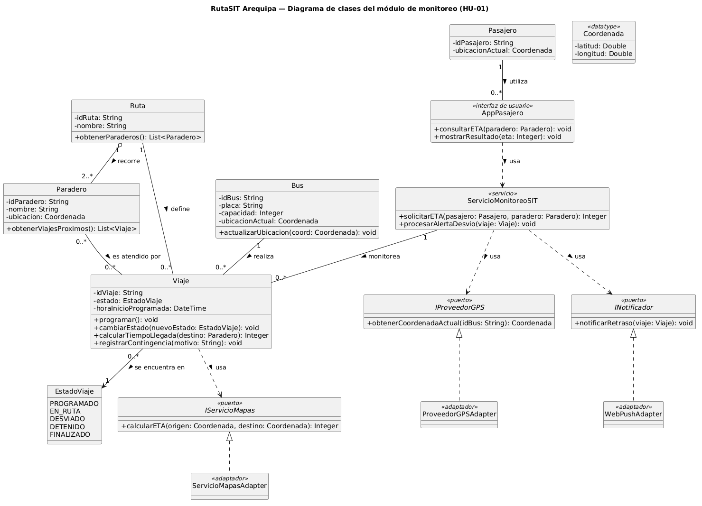

## Arquitectura C4 (Lab 06)
Modelo de arquitectura de software para **RutaSIT Arequipa** bajo el **modelo C4** (Contexto, Contenedores, Componentes y Código). Todo el modelo está formalizado como código utilizando **Structurizr DSL** (`workspace.dsl`) como **fuente única de verdad (Single Source of Truth)**, asegurando coherencia bidireccional con el [ADR-001](docs/architecture/adr/001-estilo-arquitectonico.md) (monolito modular asíncrono con FastAPI, Redis y PostgreSQL/PostGIS) y el diseño de componentes del [Laboratorio 05](docs/design/).

### Diagrama de Contexto del Sistema (Nivel 1)

El diagrama de contexto ubica a RutaSIT Arequipa en su entorno operacional, identificando a los actores directos (pasajeros y operadores de flota) y las interacciones con sistemas externos (sensores GPS en buses, mapas abiertos OSM y servicios push de contingencia):

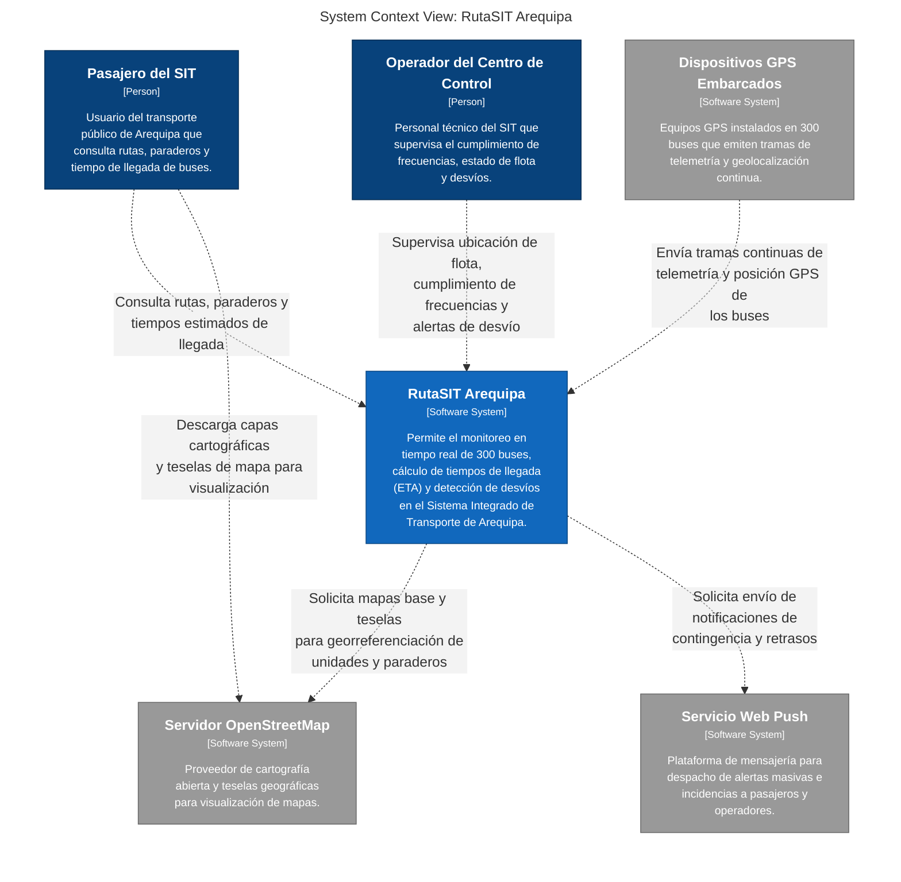

### Vistas del Modelo C4

A continuación se presentan los enlaces a las imágenes renderizadas de las cinco vistas obligatorias del modelo:

| Nivel / Vista | Descripción | Imagen renderizada |
|---|---|:---:|
| **Nivel 1: Contexto del Sistema** | Zoom panorámico: Personas, RutaSIT y Sistemas Externos (`GPS`, `OSM`, `Web Push`). | [structurizr-Contexto.png](docs/architecture/c4/img/structurizr-Contexto.png) |
| **Nivel 2: Contenedores** | Topología de 6 contenedores (`pwa`, `panel`, `api`, `worker`, `redis`, `db`), tecnologías y protocolos explícitos. | [structurizr-Contenedores.png](docs/architecture/c4/img/structurizr-Contenedores.png) |
| **Nivel 3: Componentes** | Interior del contenedor API: Ingesta GPS, ETA/Geocercas, Notificaciones, Catálogo y Supervisión. | [structurizr-Componentes.png](docs/architecture/c4/img/structurizr-Componentes.png) |
| **Vista Dinámica (HU-01)** | Flujo temporal de 8 pasos para consultar y recibir la actualización del tiempo de llegada del bus. | [structurizr-ConsultarTiempoLlegada.png](docs/architecture/c4/img/structurizr-ConsultarTiempoLlegada.png) |
| **Vista de Despliegue (Producción)** | Nodos cliente (Smartphone, PC) y VPS Ubuntu 24.04 ($\le \$12$/mes) con contenedores Docker Compose. | [structurizr-Despliegue.png](docs/architecture/c4/img/structurizr-Despliegue.png) |

#### Nivel 2: Diagrama de Contenedores
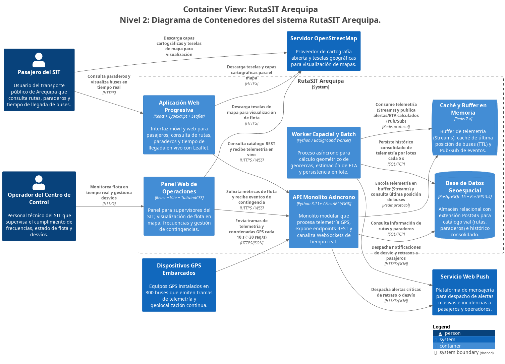

### Entregables del Lab 06
| Código | Archivo | Descripción del entregable |
|:---:|---|---|
| E1 | [inventario.md](docs/architecture/c4/inventario.md), [workspace.dsl](docs/architecture/c4/workspace.dsl) | Inventario de elementos C4 clasificados por origen y vista de Contexto N1 |
| E2 | [workspace.dsl](docs/architecture/c4/workspace.dsl) | Vista de Contenedores con 6 contenedores, tecnologías y protocolos |
| E3 | [workspace.dsl](docs/architecture/c4/workspace.dsl) | Vista de Componentes del contenedor API coherente con `docs/design/paquetes.puml` |
| E4 | [workspace.dsl](docs/architecture/c4/workspace.dsl), [comparacion.md](docs/architecture/c4/comparacion.md) | Vista Dinámica de HU-01 (8 pasos) y comparación conceptual con Secuencia UML |
| E5 | [workspace.dsl](docs/architecture/c4/workspace.dsl) | Vista de Despliegue en entorno "Producción" con Docker Compose en VPS de bajo costo |
| E6 | [export/](docs/architecture/c4/export/), [img/](docs/architecture/c4/img/), [contexto-manual.puml](docs/architecture/c4/contexto-manual.puml), [comparacion.md](docs/architecture/c4/comparacion.md) | Exportación automática CLI (PlantUML/Mermaid), renderizado PNG, diagrama manual y comparativa |
| E7 | [revision-c4.md](docs/architecture/c4/revision-c4.md), [explicacion.md](docs/architecture/c4/explicacion.md), [bitacora-ia.md](docs/architecture/bitacora-ia.md) | Lista de revisión c4model.com aplicada a las 5 vistas, falsos positivos de IA, explicación para no técnicos ($\le 120$ palabras) e interacciones registradas |
| E8 | Este README, [cuestionario.md](docs/architecture/c4/cuestionario.md) y etiqueta `v0.6-c4` | Sección C4 en README, diagrama de contexto Mermaid, enlaces a las 5 vistas, cuestionario y tag de entrega |

### Revisión Cruzada e Instrucciones de Entrega
- **Revisión cruzada entre grupos:** Se revisa el diagrama de contenedores del grupo asignado utilizando la lista de revisión oficial de c4model.com (claridad de nombres, tecnologías explícitas, protocolos en flechas unidireccionales y justificación de límites) y se registran las observaciones mediante un *Issue* en GitHub. Las observaciones recibidas en nuestro repositorio se responden y corrigen de manera oportuna.
- **Etiqueta de entrega:** Versión etiquetada con `v0.6-c4` en Git.

## Reflexión sobre el uso de la IA
La IA nos ahorró mucho tiempo en lo mecánico: armar la estructura de los drivers, escribir la sintaxis de Mermaid, PlantUML y Diagrams, y proponer alternativas que no habíamos pensado, como la variante de Django con un ingestor aparte. Donde más nos sirvió fue como abogado del diablo, porque nos obligó a ver que nuestra opción favorita podía bloquear el event loop o perder el estado si Redis se caía.
También cometió errores, y no siempre se notaban. Primero sugirió microservicios con brokers pesados para un equipo de 2 personas, y en la crítica a la Alternativa A dio cifras alarmantes ("agota los workers", "100 % de I/O") que no resistieron un cálculo simple con la Ley de Little. En el Laboratorio 06, sugirió eliminar la relación directa entre el worker y PostgreSQL bajo una falsa premisa de aislamiento de microservicios; fue descartada gracias a la lista de revisión oficial de c4model.com.
Aprendimos a tratar cada número que da la IA como una hipótesis: pasarlo a carga por segundo, compararlo con las restricciones de `drivers.md` y no copiarlo a un documento sin una fuente o un cálculo. La IA propone, pero las decisiones y su defensa son nuestras.


---

## Diseño de la Arquitectura Guiada por Atributos de Calidad (Lab 08)


En este laboratorio se diseñó la evolución arquitectónica de **RutaSIT Arequipa** ante el escenario de crecimiento:
> **Escenario de crecimiento:** *"De 300 a 1200 buses; 50,000 consultas de tiempo de llegada en hora punta. Atributo crítico: Rendimiento en tiempo real."*

### 1. Árbol de Utilidad
El árbol de utilidad define los 4 atributos de calidad, sub-atributos y 8 escenarios cuantitativos:
* Archivo fuente: [`docs/architecture/utilidad/arbol.dot`](docs/architecture/utilidad/arbol.dot)
* Imagen renderizada: [`docs/architecture/utilidad/arbol.png`](docs/architecture/utilidad/arbol.png)

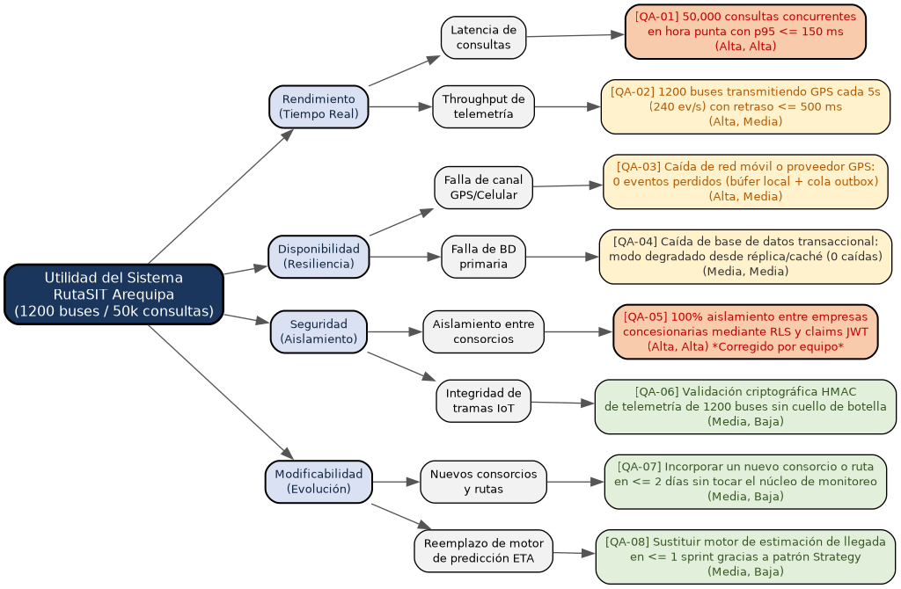

### 2. Tabla de Iteraciones de ADD

| Iteración | Escenario Priorizado | Táctica de Diseño (Bass et al., 2021) | Evidencia Cuantitativa | ¿Cumple? | ADR Asociado |
| :---: | :--- | :--- | :--- | :---: | :---: |
| **Iteración 1 (E2)** | `[QA-01]` 50k consultas en hora punta con $p95 \le 150\text{ ms}$. | *Maintain copies of data* (Caché LRU 10s) + *Bound execution times* (Índice compuesto). | Simulación M/G/c ($\lambda=30\text{ req/s}$): $p95 = \mathbf{21.3\text{ ms}}$ (vs $183.5\text{ ms}$ sin táctica). | **SÍ** ($7\times$ holgura) | [ADR-006](docs/architecture/adr/006-cache-estimaciones-llegada.md) |
| **Iteración 2 (E4)** | `[QA-03]` Falla de red celular o proveedor GPS: 0 eventos perdidos. | *Exception handling* (Circuit Breaker) + *Queue* (Outbox en PostgreSQL). | Simulación Monte Carlo: **0 pérdidas** (vs 277 perdidos) y $96.6\%$ menos llamadas en caída. | **SÍ** (100% resiliente) | [ADR-007](docs/architecture/adr/007-circuit-breaker-outbox-telemetria.md) |
| **Iteración 3 (E4)** | `[QA-05] / [QA-07]` Aislamiento 100% entre consorcios y alta en $\le 2$ días. | *Authorize access* (JWT claims) + *Limit access* (Row-Level Security en PostgreSQL). | Aislamiento forzado por kernel de BD; alta de consorcio en **15 minutos** sin alterar código. | **SÍ** (Aislamiento total) | [ADR-008](docs/architecture/adr/008-multitenencia-consorcios-rls.md) |

### 3. Fitness Functions en Integración Continua (CI)
Se establecieron compuertas de calidad automáticas ejecutadas en cada Pull Request mediante GitHub Actions:
* **Estructurales (`.importlinter`):**
  * `FF-01`: Capas del monolito modular sin dependencias circulares (`servicio -> decoradores -> adaptadores -> dominio`).
  * `FF-02`: Dominio puro sin acoplamiento a adaptadores ni librerías externas.
  * `FF-03`: Componente de IA aislado mediante Facade/Proxy (ADR-005).
* **De Calidad (`tests/test_fitness.py`):**
  * `FF-04`: Presupuesto de latencia $p95 \le 150\text{ ms}$ en simulación bajo carga.
  * `FF-05`: Garantía de 0 eventos telemétricos perdidos ante caídas de red.
  * `FF-06`: Protección del canal (Circuit Breaker reduce $>90\%$ de llamadas inútiles).
  * `FF-07`: Verificación del contrato de aislamiento multitenant por `consorcio_id`.

### 4. Entregables del Laboratorio 08
| Código | Archivos del Entregable | Descripción |
| :---: | :--- | :--- |
| **E1** | [`docs/architecture/utilidad/`](docs/architecture/utilidad/) | Árbol de utilidad en Graphviz (`arbol.dot` y `arbol.png`) con 4 atributos y escenarios medibles. |
| **E2** | [`docs/architecture/add/iteracion-1.md`](docs/architecture/add/iteracion-1.md), [`fitness/rendimiento.py`](fitness/rendimiento.py) | Iteración 1 de ADD, simulación de cola M/G/c y gráfico de sensibilidad. |
| **E3** | [`docs/architecture/atam-lite.md`](docs/architecture/atam-lite.md) | Evaluación ATAM-lite con hallazgos (sensibilidades, trade-offs, riesgos) y respuesta a issue. |
| **E4** | [`docs/architecture/add/iteracion-2.md`](docs/architecture/add/iteracion-2.md), [`iteracion-3.md`](docs/architecture/add/iteracion-3.md), [`fitness/disponibilidad.py`](fitness/disponibilidad.py) | Iteraciones 2 y 3 de ADD con simulación Monte Carlo y comparación de multitenencia. |
| **E5** | [`.importlinter`](.importlinter), [`tests/test_fitness.py`](tests/test_fitness.py), [`.github/workflows/fitness.yml`](.github/workflows/fitness.yml) | Contratos de arquitectura en import-linter, pruebas de calidad en pytest y workflow de CI. |
| **E6** | [`docs/architecture/adr/`](docs/architecture/adr/), [`docs/architecture/c4/workspace.dsl`](docs/architecture/c4/workspace.dsl) | ADR-005 a ADR-008 y modelo C4 actualizado con trazabilidad `[QA-xx]`. |
| **E7** | [`docs/architecture/atam-lite.md`](docs/architecture/atam-lite.md), [`docs/architecture/bitacora-ia.md`](docs/architecture/bitacora-ia.md) | Matriz de riesgos, mitigaciones e interacciones de IA (con refutación de falsos positivos). |
| **E8** | [`README.md`](README.md), etiqueta `v0.8-arquitectura` | Sección de Lab 08 en README, badges y tag de versión para entrega. |


---

## Sistemas agénticos (Laboratorio 10)

En este laboratorio se diseñó, construyó y coordinó un sistema agéntico autónomo y supervisado para el diagnóstico y resolución de incidencias complejas en el repositorio de **RutaSIT Arequipa** (siguiendo los principios de SWE-bench y la arquitectura de agentes de Albada 2025 y Koenigstein 2026).

### 1. Máquina de Estados del Agente ReAct
El bucle ReAct (*Reasoning + Acting*) opera como una máquina de estados finita que valida contratos y políticas de seguridad antes de invocar cualquier herramienta:

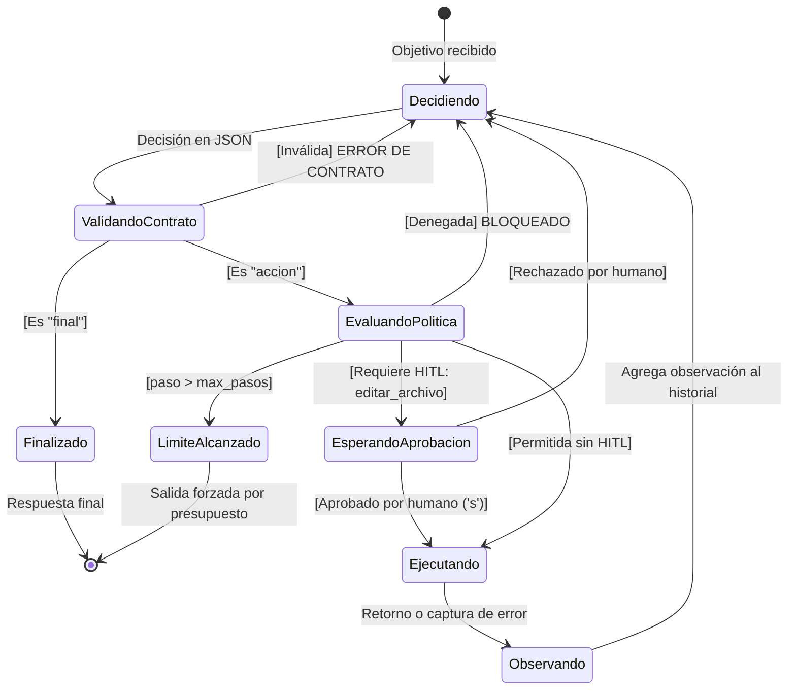
*(Diagrama PlantUML formal disponible en [`agentes/diseno/estados.puml`](agentes/diseno/estados.puml) y renderizado en [`agentes/diseno/estados.png`](agentes/diseno/estados.png)).*

### 2. Diagrama de Trayectoria (Orquestador Actor-Crítico sobre ISSUE-02)
El siguiente diagrama muestra la coordinación por gestor (Planificador) y el bucle Actor-Crítico en 2 rondas, donde el revisor detectó una potencial división por cero antes de la aprobación humana:

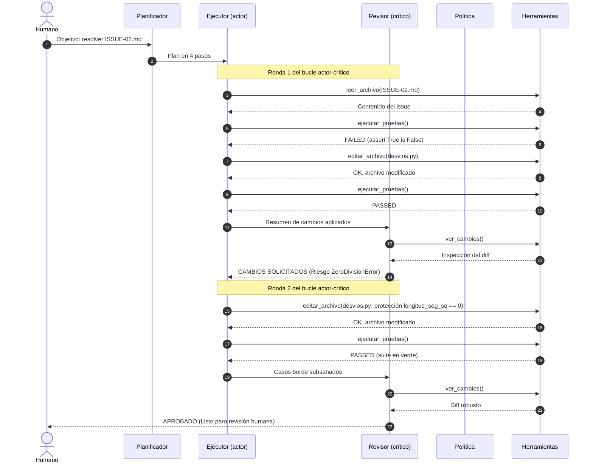

### 3. Tabla Consolidada de Métricas de los 3 Issues
Comparación del desempeño agéntico en las tres incidencias resueltas:

| Métrica de Observabilidad | ISSUE-01 (E2: ReAct Clásico) | ISSUE-02: Agente Único | ISSUE-02: Actor-Crítico (E5) | ISSUE-03 (E4: AST + Notas) |
| :--- | :--- | :--- | :--- | :--- |
| **Defecto Resuelto** | ETA negativo si bus pasó paradero | Falsos desvíos en curvas | Falsos desvíos en curvas + casos borde | Crash TypeError por GPS sin datos |
| **Arquetipo** | Agente ReAct simple | Agente ReAct simple | Planificador + [Ejecutor $\leftrightarrow$ Revisor] | ReAct con AST + Memoria de Notas |
| **Rondas** | 1 ronda | 1 ronda | 2 rondas | 1 ronda |
| **Pasos Totales** | 11 pasos | 7 pasos | 15 pasos acumulados | 8 pasos |
| **Acciones Permitidas** | 9 acciones | 6 acciones | 13 acciones | 7 acciones |
| **Rechazos por Contrato** | 1 (`buscar_archivos` inventada) | 0 | 0 | 0 |
| **Contexto Acumulado** | 24,180 caracteres (~6,045 tokens) | 9,466 caracteres (~2,366 tokens) | 26,976 caracteres (~6,744 tokens) | 14,801 caracteres (~3,700 tokens) |
| **Hallazgo Clave** | Contrato forzó autocorrección. | No detectó riesgo de `ZeroDivisionError`. | **El revisor detectó `ZeroDivisionError`** y rutas de 1 punto. | **-38.8% de contexto** gracias a `mapa_repo()` con AST. |
| **Estado de Pruebas** | 100% verde (3/3) | 100% verde (2/2) | 100% verde (2/2 + casos borde) | 100% verde (1/1) |

### 4. Enlaces a Entregables Oficiales de Lab 10
* **Lienzo de diseño (7 decisiones):** [`agentes/diseno/lienzo.md`](agentes/diseno/lienzo.md)
* **Máquina de estados PlantUML:** [`agentes/diseno/estados.puml`](agentes/diseno/estados.puml) y render en [`agentes/diseno/estados.png`](agentes/diseno/estados.png)
* **Hoja de ruta de autonomía:** [`agentes/delegacion.md`](agentes/delegacion.md)
* **Métricas y observabilidad:** [`agentes/observacion.md`](agentes/observacion.md)
* **Bitácora de interacciones con IA:** [`agentes/bitacora-ia.md`](agentes/bitacora-ia.md)
* **Decisión de Arquitectura:** [`docs/architecture/adr/010-sistema-agentico.md`](docs/architecture/adr/010-sistema-agentico.md)
* **Informe en Word/ODT:** [`informe_laboratorio_10.docx`](/home/andersp666/informe_lab10_cs/informe_laboratorio_10.docx) y [`informe_laboratorio_10.odt`](/home/andersp666/informe_lab10_cs/informe_laboratorio_10.odt)

## Prompt engineering (Lab 09)

Los prompts se tratan como código: contrato de salida en `prompts/criterios/asserts/esquema.json`, dataset de 8 historias, aserciones A1–A6 en promptfoo y respuestas grabadas con un asistente de IA (`prompts/record.py`). Tarea A: criterios de aceptación Gherkin a partir de historias de RutaSIT. Tarea B: pruebas pytest para el cálculo de ETA. Evaluación: `sh prompts/evaluar.sh criterios` (requiere Node 20+ y `PROMPTFOO_PYTHON` si `python` no está en el PATH).

| Versión | Cambio | Casos aprobados | Tasa |
|---|---|---|---:|
| v1 | Prompt ingenuo | 0/8 | 0 % |
| v2 | Rol, contexto y formato JSON | 1/8 | 12,5 % |
| v3 | Restricciones, delimitadores, ejemplo y verificación INVEST | 3/8 | 37,5 % |
| v3.1 | INVEST tolerante: las dudas menores no bloquean los escenarios | 8/8 | 100 % |

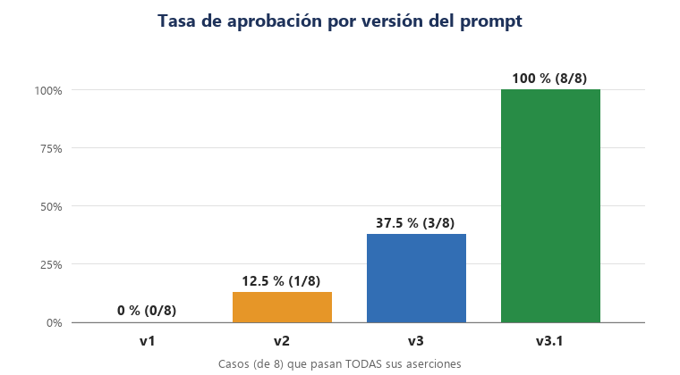

Lecciones: la v3 llegó a 100 % con las aserciones A1–A5 pero rechazaba todas las historias válidas; la aserción A6 lo reveló. Con 8 casos, 100 % no prueba que el prompt sea bueno. Red teaming: v3.1 resiste 4/5 ataques y v4 5/5 ([red-team.md](prompts/seguridad/red-team.md)); no determinismo en [no-determinismo.md](prompts/no-determinismo.md); bitácora en [bitacora-ia.md](prompts/bitacora-ia.md). Integración: `src/monitoreo/generador_criterios.py` detrás de `IProveedorLLM`.


## Servidor MCP (Lab 11)

El proyecto se publica como servidor MCP `rutasit` ([ADR-011](docs/architecture/adr/011-servidor-mcp.md)) para que
Claude Code, VS Code + Copilot, MCP Inspector o el agente del Lab 10 usen las mismas herramientas. Datos ficticios.

| Primitiva | Nombre | Escritura |
|---|---|---|
| Herramienta | `buses_en_ruta(id_ruta)` | No |
| Herramienta | `tiempo_llegada(id_bus, id_paradero, hora_actual, estrategia)` | No |
| Herramienta | `verificar_desvio(id_bus)` | No |
| Herramienta | `reportar_desvio(id_bus, descripcion)` | **Sí, solo crea** (pide aprobación) |
| Recurso | `rutasit://agents-md`, `rutasit://rutas/mapa`, `rutasit://adr/{numero}` | No |
| Prompt | `aviso_usuarios(id_ruta, motivo)`, `revisar_cambio(diff)` | No |

```bash
python -m venv .venv && .venv/bin/pip install -r agentes/mcp/requirements.txt
.venv/bin/python -m pytest -q agentes/mcp/pruebas          # 20 pruebas de contrato
.venv/bin/python agentes/mcp/cliente/explorar.py           # host mínimo
.venv/bin/python agentes/mcp/operador_mcp.py               # agente del Lab 10 vía MCP (con aprobación)
.venv/bin/python agentes/mcp/cliente/traza_mcp.py          # diagrama de secuencia + métricas
.venv/bin/python agentes/mcp/cliente/auditar.py agentes/mcp/terceros/clima_mcp.py
```

**Conectarlo a un host:** Claude Code lee `.mcp.json` de la raíz (o `claude mcp add rutasit -- .venv/bin/python
agentes/mcp/servidor_mcp/rutasit_mcp.py`); VS Code usa `.vscode/mcp.json`. Detalle de las 5 consultas en
[`agentes/mcp/uso-en-host.md`](agentes/mcp/uso-en-host.md).

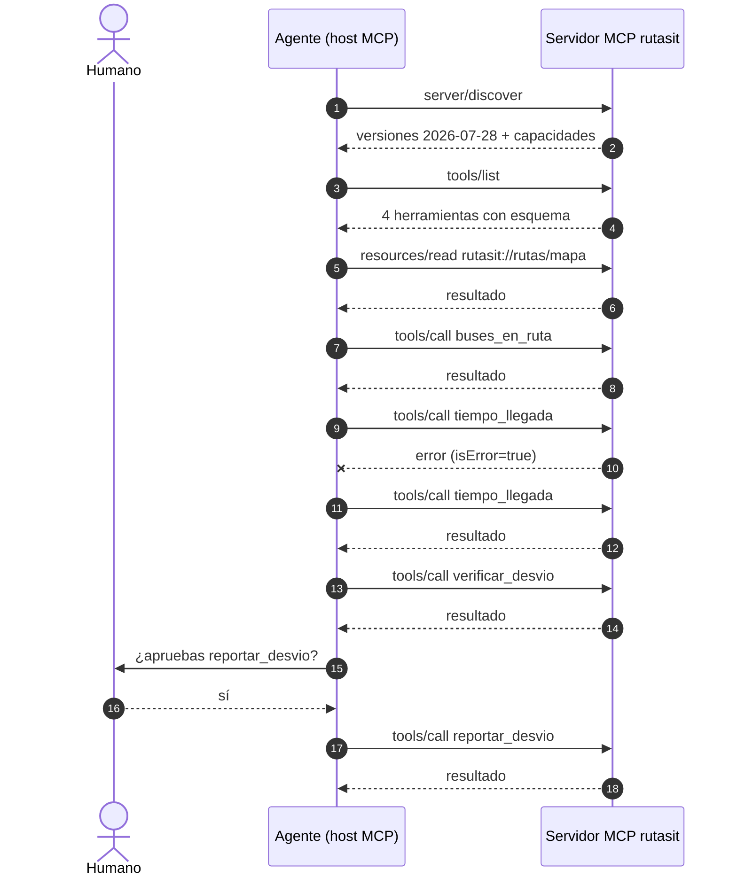

Entregables: [catálogo](agentes/mcp/diseno/catalogo-mcp.md) · [Inspector](agentes/mcp/pruebas/inspector.md) ·
[protocolo y costo](agentes/mcp/protocolo.md) · [seguridad](agentes/mcp/seguridad.md) ·
[bitácora IA](agentes/mcp/bitacora-ia.md). Etiqueta: `v1.1-mcp`.

## Desarrollo asistido por IA (Lab 12)

En el Laboratorio 12 se implementó la historia **HU-12: Estimar la hora de llegada al paradero** (`src/monitoreo/llegada.py`) aplicando **Desarrollo Guiado por Especificación (SDD)** y **TDD** con apoyo del asistente en modo agente (**Antigravity / Gemini**), siguiendo las reglas definidas en [`AGENTS.md`](AGENTS.md) y la política formalizada en [`ADR-012`](docs/architecture/adr/012-uso-de-ia.md).

### Flujo seguido
1. **Contexto y compuertas (E1):** `AGENTS.md`, `CLAUDE.md`, `pyproject.toml`, `calidad/verificar.py` y workflow CI `.github/workflows/calidad.yml`.
2. **Especificación y plan (E2):** `specs/hu-12/spec.md` (5 escenarios Gherkin incluyendo `YA_PASO`, `SIN_GPS` y validación geográfica de Arequipa), `plan.md` y `tasks.md`.
3. **TDD con IA (E3):** pruebas en rojo (`tests/test_hu12_llegada.py`), implementación mínima reutilizando `FabricaEstrategiasETA` y registro en [`docs/lab12/sesion-ia.md`](docs/lab12/sesion-ia.md).
4. **Revisión y compuertas (E4–E5):** revisión cruzada IA vs. humana ([`docs/lab12/revision-pr.md`](docs/lab12/revision-pr.md)), nueva compuerta de arquitectura con `import-linter` y comparación contra borradores sin revisar ([`docs/lab12/comparativa-compuertas.md`](docs/lab12/comparativa-compuertas.md)).
5. **Experimento y bitácora (E6–E7):** [`docs/lab12/experimento.csv`](docs/lab12/experimento.csv), [`docs/lab12/experimento.md`](docs/lab12/experimento.md) y [`docs/lab12/bitacora-ia.md`](docs/lab12/bitacora-ia.md).
6. **Reto opcional:** comando reutilizable `/nueva-historia` demostrado con [`specs/hu-13/`](specs/hu-13/spec.md).

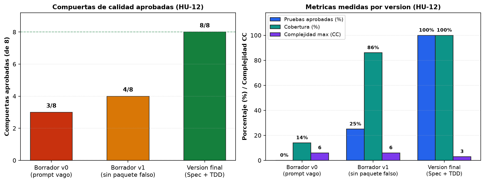

### Resultado del mini experimento de productividad (E6)
| Integrante | Tarea | Modo | Minutos | Iteraciones IA | Compuertas 1.er intento | Defectos revisión |
|---|---|---|---:|---:|---:|---:|
| Arce Valencia Anderson Lino | T-A (Validación geográfica/velocidad) | Con IA | 14 | 2 | 7/8 | 1 |
| Carlos Ccamaqque Wilson Freddy | T-A (Validación geográfica/velocidad) | Sin IA | 21 | 0 | 8/8 | 0 |
| Carlos Ccamaqque Wilson Freddy | T-B (Cálculo ETA y casos borde) | Con IA | 18 | 3 | 6/8 | 2 |
| Arce Valencia Anderson Lino | T-B (Cálculo ETA y casos borde) | Sin IA | 24 | 0 | 8/8 | 0 |
