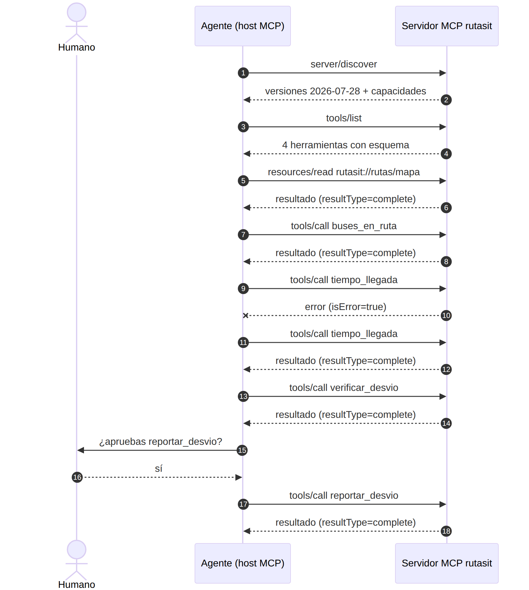
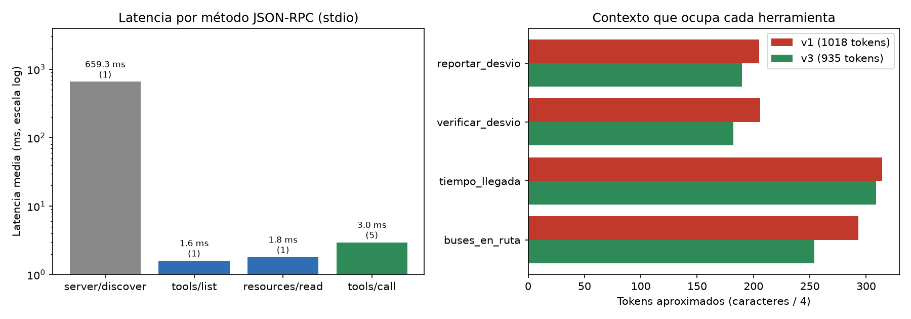

# E6. Análisis del protocolo y del costo de contexto

Traza: `trazas/mcp_trafico.jsonl` (capturada por `cliente/espia.py` durante `operador_mcp.py`).
Diagrama: `python agentes/mcp/cliente/traza_mcp.py` → `trazas/mcp_trafico.mmd` (renderizado en `img/secuencia_mcp.png`).
Métricas y gráficos: `cliente/traza_mcp.py`, `cliente/costo_catalogo.py`, `cliente/graficos.py`.

## Lectura de la traza

| Pregunta | Respuesta según la traza |
|---|---|
| ¿Cuántos mensajes? | 16 mensajes JSON-RPC (≈10,8 KB) para responder la consulta del centro de control. |
| ¿Dónde se va el tiempo? | En arrancar el servidor: `server/discover` tarda ≈ 0,66 s porque incluye levantar Python e importar el SDK. Después cada llamada tarda entre 1 y 9 ms por stdio. |
| ¿Cuánto contexto cuesta el catálogo? | ≈ 1018 tokens en la versión 1 y ≈ 935 en la final, en **cada** llamada al modelo. |
| ¿Hubo errores? | 1, de negocio (`tiempo_llegada` con hora `07:30`); el agente leyó el mensaje y repitió con `2026-11-25T07:30`. |
| ¿Sesión? | No: cada petición lleva en `_meta` la versión `2026-07-28` y la identidad del cliente; no hay `initialize`. |

## Optimización del catálogo

| Versión | Cambio | Tokens del catálogo |
|---|---|---|
| v1 | Descripciones largas en varias líneas; `BusResumen` incluía `placa`. | ≈ 1018 |
| v2 | Descripciones de una o dos líneas sin repetir lo que ya dicen el esquema o los errores; `placa` fuera de la salida (el agente no la usa y es un dato menos que exponer). | ≈ 920 (−9,6 %) |
| v3 (final) | Se devolvió una pista a `tiempo_llegada` ("ver recurso rutasit://rutas/mapa") porque Claude Code buscaba el ID del paradero con `grep` en el repositorio (E5). | ≈ 935 (−8,2 % respecto a v1) |

¿Siguió eligiendo bien las herramientas? Sí. El agente del Lab 10 (decisiones grabadas) produjo la misma
trayectoria y el mismo resultado con v2 y v3, y en el host real Claude Code eligió las herramientas correctas en
las cinco consultas. La lección fue que recortar tiene un límite: quitar la referencia al mapa ahorraba
pocos tokens pero hacía que el host saliera del servidor, así que se aceptaron 15 tokens más a cambio de claridad.
La mayor parte del costo restante está en los `outputSchema` (anidados y con títulos generados por Pydantic),
no en las descripciones.
