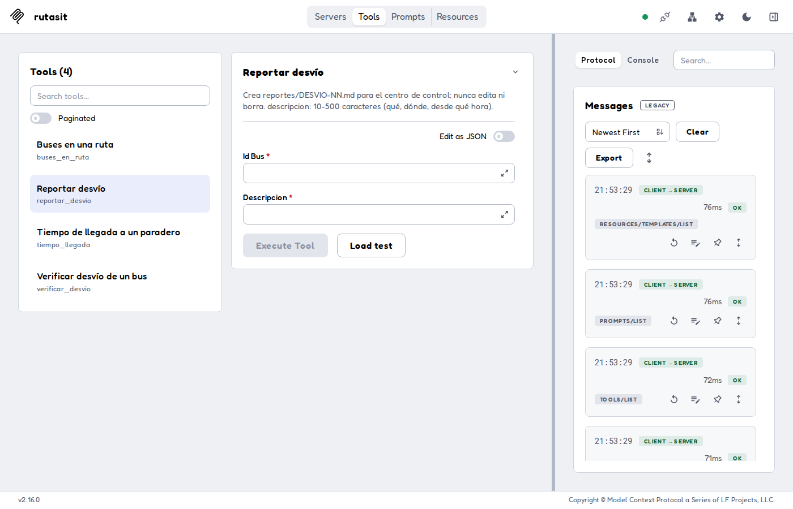
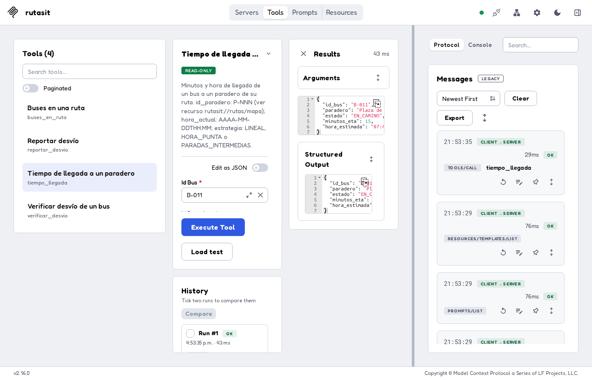
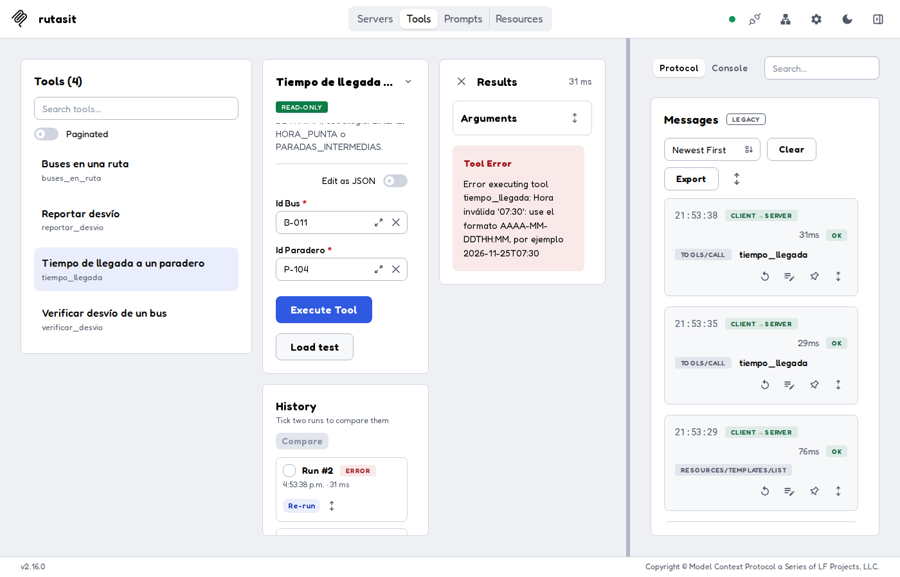
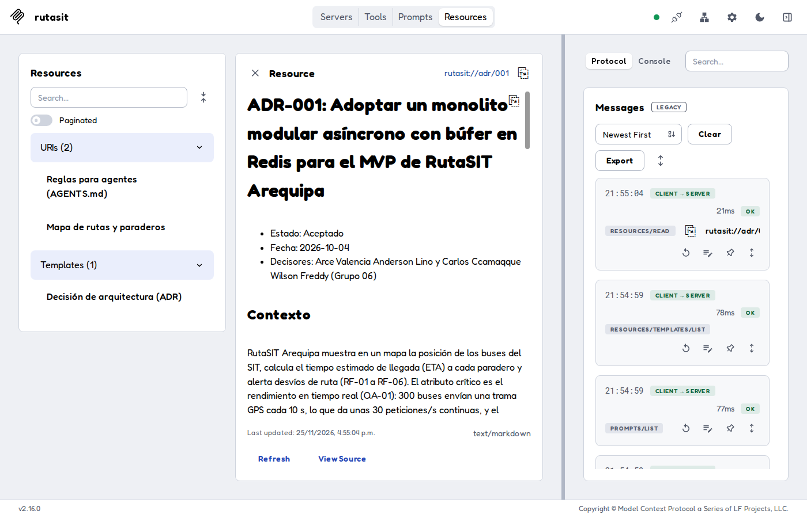
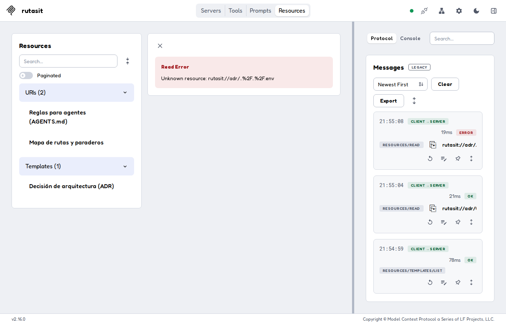

# E3. Evidencias de MCP Inspector

Comando (Inspector 2.16 requiere Node 22 o superior; con Node 18 falla con `styleText`):

```bash
npx -y -p node@22 -p @modelcontextprotocol/inspector -c "mcp-inspector .venv/bin/python agentes/mcp/servidor_mcp/rutasit_mcp.py"
```

Inspector se conectó con el protocolo **2025-11-25** (modo *legacy*, con `initialize`), mientras que nuestro
cliente y el agente usan **2026-07-28** (`server/discover`). El mismo servidor atiende a los dos, que es lo que
promete la especificación para los hosts que aún no se actualizan.

## 1. Catálogo


Las cuatro herramientas aparecen con su título y nombre. `tiempo_llegada` muestra la etiqueta **READ-ONLY**;
`reportar_desvio` no la tiene, porque es la única escritura. Su descripción se entiende sin leer el código:
qué crea, que nunca edita ni borra y qué longitud acepta `descripcion`.

## 2. Llamada correcta


`tiempo_llegada(B-011, P-104, 2026-11-25T07:30)` devuelve el mismo JSON en *Results* y en *Structured Output*:
`EN_CAMINO`, 15 minutos, llegada 07:45. El `outputSchema` lo publica el tipo de retorno `Llegada` (TypedDict).

## 3. Llamada con error


Con `hora_actual = "07:30"` el resultado es un **Tool Error** (`isError: true`), no un fallo del protocolo
(el mensaje JSON-RPC aparece como OK en el panel derecho). El texto explica cómo corregirlo:
"use el formato AAAA-MM-DDTHH:MM, por ejemplo 2026-11-25T07:30".

## 4. Recurso plantilla



`rutasit://adr/001` devuelve el ADR-001 en Markdown. `rutasit://adr/../../.env` se rechaza (*Read Error*):
la URI ni siquiera coincide con la plantilla y, si coincidiera, la expresión `\d{3}` del servidor la bloquearía.
