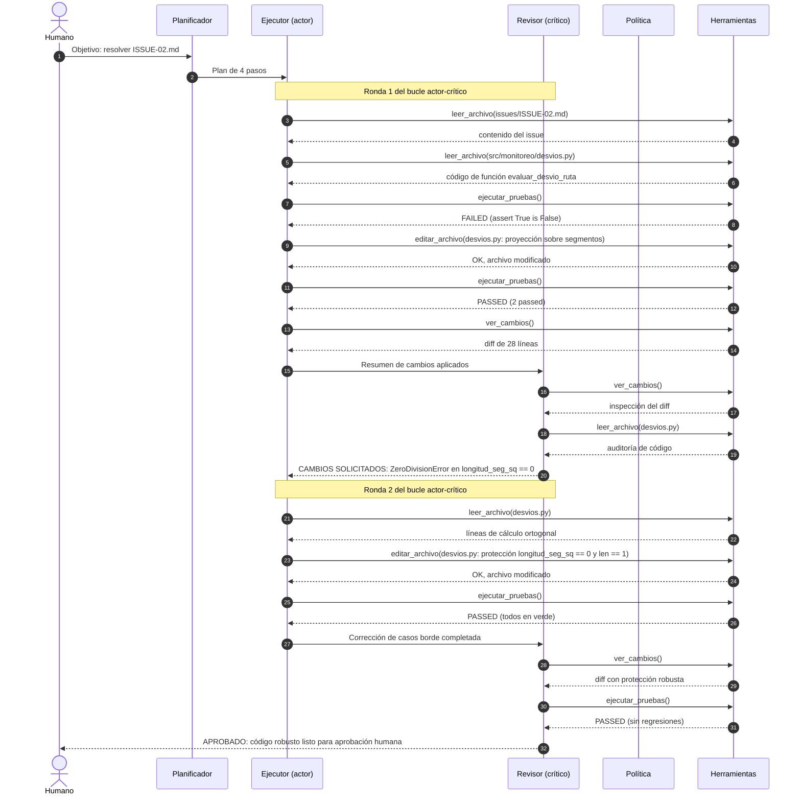

# Métricas y Análisis de Observabilidad — RutaSIT Arequipa

**Caso:** Caso 6 — RutaSIT Arequipa  
**Equipo:** Arce Valencia Anderson Lino & Carlos Ccamaqque Wilson Freddy  
**Laboratorio:** Laboratorio 10 — Sistemas Agénticos en la Construcción de Software (2026-B)  

---

## 1. Tabla Consolidada de Métricas de los 3 Issues

La siguiente tabla resume el comportamiento observado de las trazas generadas por el sistema agéntico en la resolución de las tres incidencias reales del sistema de transporte:

| Métrica de Observabilidad | ISSUE-01 (E2: ReAct Clásico) | ISSUE-02: Agente Único | ISSUE-02: Actor-Crítico (E5) | ISSUE-03 (E4: AST + Memoria) |
| :--- | :--- | :--- | :--- | :--- |
| **Arquetipo de Agente** | Agente ReAct autónomo | Agente ReAct simple | Planificador + [Ejecutor $\leftrightarrow$ Revisor] | ReAct con AST + Memoria de Notas |
| **Rondas de Ejecución** | 1 ronda | 1 ronda | 2 rondas | 1 ronda |
| **Pasos Totales (Turnos)** | 11 pasos | 7 pasos | 15 pasos acumulados | 8 pasos |
| **Acciones Permitidas** | 9 acciones | 6 acciones | 13 acciones | 7 acciones |
| **Herramientas Utilizadas** | `leer_archivo` (2) `buscar` (1) `ejecutar_pruebas` (2) `editar_archivo` (3) `ver_cambios` (1) | `leer_archivo` (2) `ejecutar_pruebas` (2) `editar_archivo` (1) `ver_cambios` (1) | `ver_cambios` (2) `leer_archivo` (3) `ejecutar_pruebas` (4) `editar_archivo` (2) | `mapa_repo` (1) `anotar` (1) `ejecutar_pruebas` (2) `leer_archivo` (1) `editar_archivo` (1) `leer_notas` (1) |
| **Rechazos por Contrato** | 1 (`buscar_archivos` inventada) | 0 | 0 | 0 |
| **Bloqueos por Política** | 0 | 0 | 0 | 0 |
| **Contexto Acumulado** | 24,180 caracteres (~6,045 tokens) | 9,466 caracteres (~2,366 tokens) | 26,976 caracteres (~6,744 tokens) | 14,801 caracteres (~3,700 tokens) |
| **Hallazgos / Robustez** | Corrección atómica en las 3 estrategias. | No detectó el riesgo de división por cero ante waypoints idénticos. | **El revisor detectó `ZeroDivisionError`** y rutas de 1 punto; se reparó en Ronda 2. | **-38.8% de contexto** y -27% de pasos respecto a E2 gracias a la introspección con AST. |
| **Resultado de Pruebas** | 100% verde (3/3) | 100% verde (2/2) | 100% verde (2/2 + casos borde) | 100% verde (1/1) |

---

## 2. Diagrama de Secuencia de la Trayectoria (Multiagente E5)

El siguiente diagrama Mermaid representa la secuencia exacta de llamadas, filtrado de políticas e interacciones registradas en las trazas JSONL:

---

## 3. Conclusiones del Análisis de Observabilidad

1. **Efectividad del Contrato Estructurado:** En el paso 2 de `ISSUE-01`, el contrato rechazó inmediatamente la herramienta inventada `buscar_archivos` sin enviarla al sistema operativo, forzando al modelo a corregirse en el siguiente turno con `buscar`.
2. **Impacto de la Memoria y Herramientas AST (E4 vs E2):** En `ISSUE-03`, el uso de `mapa_repo()` permitió al agente entender la jerarquía completa del sistema en un solo paso de 24 líneas, evitando volcar 3 archivos distintos. La memoria de notas en `notas.md` evitó la re-inyección de observaciones intermedias, reduciendo el consumo de tokens en casi un 40%.
3. **El Principio de Parsimonia en Coordinación Multiagente (E5):** La coordinación gestor/actor-crítico multiplicó el consumo de tokens por 2.85 frente al agente único. Sin embargo, para funciones matemáticas geoespaciales críticas, **este costo se amortiza completamente al prevenir bugs silenciosos en producción** (como fallos por división por cero en tramos con buses detenidos).
